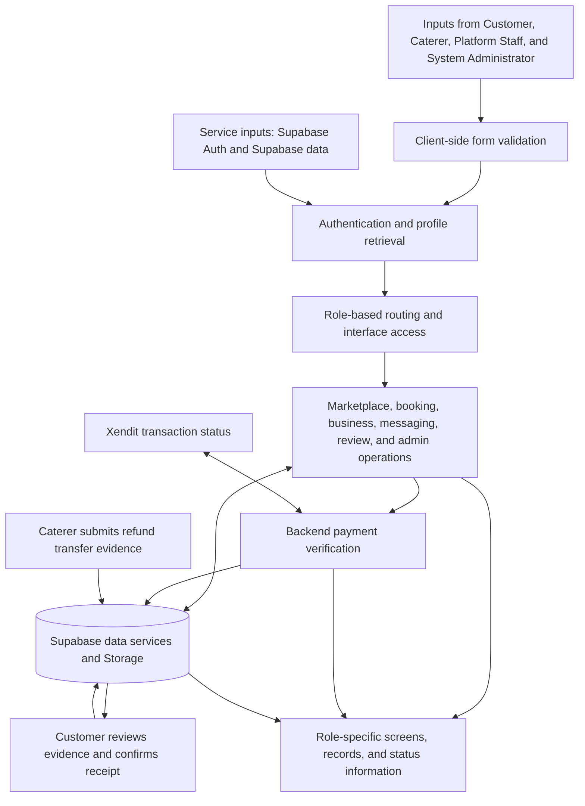

# CHAPTER V — DESIGN OF THE PROTOTYPE

## 5.1 Introduction

CaterConnect is an online marketplace prototype that connects customers seeking catering services with caterers offering event packages. The system has four user roles: Customer, Caterer, Platform Staff, and System Administrator. Customers and caterers use the Expo React Native mobile application. Platform Staff and System Administrators use the React web portal.

The frontends use Supabase services for authentication and data access. The inspected code also uses Supabase Storage, database RPC calls, and Edge Functions for selected operations. The prototype provides role-specific interfaces for marketplace discovery, booking, business management, operational review, and administration. This chapter describes those interfaces and source-observed workflows. It does not treat the presence of a client screen as proof that its database permissions or deployment configuration are complete.

## 5.2 Operational Framework

### 5.2.1 Input

The prototype receives information from users and connected services. Customer inputs include account details, caterer search criteria, package selections, event details, guest counts, optional menu additions, booking conversations, complaints, and reviews. Caterer inputs include business profile information, verification documents, package and menu details, availability, booking responses, subscription selections, and refund transfer evidence. Platform Staff and System Administrators provide credentials and use the controls available in their respective web portal modules.

Supabase Auth receives authentication requests. For payment-related operations, the backend functions use transaction information obtained from Xendit to verify payment status. The application also receives data returned from Supabase queries, Storage operations, RPC calls, and backend functions.

### 5.2.2 Process

The application validates form values in the client and sends requests to Supabase. Authentication establishes a session, after which the applications retrieve a profile and use its role to display or guard the corresponding areas. Database authorization remains the responsibility of the deployed Supabase configuration.

Customers can browse caterers and packages, compare offers, submit booking requests, and communicate through booking-related messaging interfaces. Caterers can manage their business information and offers, availability, and booking responses. Payment verification is a separate process: backend functions check payment status with Xendit before updating the relevant booking or subscription data.

Refund transfer handling is a distinct workflow. Caterers can submit transfer evidence, and customers can review the evidence and confirm receipt. Evidence submission is not itself confirmation that funds have been received. Staff and System Administrators use their portal screens to review and manage the operations assigned to those areas.

### 5.2.3 Output

The outputs include role-specific screens and the information retrieved or updated through the system, such as caterer listings, package details, bookings, conversations, reviews, complaints, notifications, and administrative records. Payment outputs depend on the backend verification result and a corresponding data update. Refund outputs include evidence information and the customer’s receipt-confirmation action; they do not establish that the application transfers funds.

### 5.2.4 Input-Process-Output Diagram

Figure 5.1 presents the source-based Input-Process-Output model. It distinguishes Xendit payment verification from the refund evidence and receipt-confirmation workflow.

**Figure 5.1. Input-Process-Output Model of CaterConnect**

## 5.3 The User-Interface Design

The mobile interface is organized through Expo Router authentication, customer, and caterer route groups. The web portal uses React Router to provide staff and administrator areas. The following subsections describe the modules visible in the inspected source.

### 5.3.1 Login and Authentication Module

The mobile authentication area includes welcome, registration, login, and email-verification screens. The registration interface offers Customer and Caterer account types. The web portal provides a login screen for Platform Staff and System Administrators. After authentication, the portal retrieves profile information and routes recognized roles to the corresponding portal area. Staff account provisioning is a separate administrator-facing workflow.

Email confirmation depends on Supabase configuration. The source inspection did not establish that all mobile actions universally require a verified email address. The password-recovery link on the reviewed portal login screen has no active handler.

**[Screenshot placeholder] Figure 5.2. Mobile welcome, registration, and login interfaces.**

**[Screenshot placeholder] Figure 5.3. Platform Staff and System Administrator portal login interface.**

### 5.3.2 Customer Module

The Customer module is provided in the mobile application. It includes home and caterer search, caterer profiles, package comparison, a booking wizard, booking history and details, messages, reviews, complaints, notifications, and profile screens. Customers can inspect available caterer and package information, enter event details, and submit a booking request through the booking interface.

Payment-related screens and backend functions support verification of eligible booking payments. This is separate from refund handling: the customer booking screens also provide access to refund transfer evidence submitted by a caterer and a customer action to confirm receipt. No general manual booking-receipt upload and approval workflow is asserted here.

**[Screenshot placeholder] Figure 5.4. Customer home, caterer search, and caterer profile.**

**[Screenshot placeholder] Figure 5.5. Customer booking wizard and booking review.**

**[Screenshot placeholder] Figure 5.6. Customer booking details, messaging, and reviews.**

**[Screenshot placeholder] Figure 5.7. Customer refund transfer evidence and receipt-confirmation interface.**

### 5.3.3 Caterer Module

The Caterer module is provided in the mobile application. Its reviewed screens include a dashboard, business profile editing, verification-document interfaces, package and menu management, availability, bookings, messages, complaints, notifications, reports, subscription-related screens, and FAQs.

Caterers can manage business and offer information and interact with booking workflows through the available screens. Business verification is separate from Supabase email confirmation. The repository contains interfaces for caterer-submitted refund transfer evidence; this does not mean that funds are transferred by the application.

**[Screenshot placeholder] Figure 5.8. Caterer dashboard and business profile.**

**[Screenshot placeholder] Figure 5.9. Caterer package, menu, and availability interfaces.**

**[Screenshot placeholder] Figure 5.10. Caterer booking management and refund evidence submission.**

### 5.3.4 Platform Staff Module

The Platform Staff module is provided through the web portal under the `/staff` route. Its pages include a dashboard, caterer verification, subscription management, complaints, booking monitoring, account monitoring, and refund management. These interfaces support operational review and the actions exposed by the respective screens. The refund management screen is described as monitoring and evidence review; it is not presented as a staff disbursement or customer receipt-confirmation interface.

**[Screenshot placeholder] Figure 5.11. Platform Staff dashboard and operational queues.**

**[Screenshot placeholder] Figure 5.12. Platform Staff caterer verification and complaint management.**

**[Screenshot placeholder] Figure 5.13. Platform Staff booking, account, and refund monitoring.**

### 5.3.5 System Administrator Module

The System Administrator module is provided through the web portal under the `/admin` route. Its pages include a dashboard, user management, revenue, reports, activity logs, platform settings, and maintenance/security. The settings area includes a staff-provisioning interface connected to a backend function. The code also contains role-management and maintenance RPC calls; successful operation depends on the corresponding server-side functions and permissions being configured.

**[Screenshot placeholder] Figure 5.14. System Administrator dashboard and user management.**

**[Screenshot placeholder] Figure 5.15. System Administrator revenue, reports, and activity logs.**

**[Screenshot placeholder] Figure 5.16. System Administrator platform settings and maintenance/security.**

### 5.3.6 Other Modules

Messaging, reviews, complaints, notifications, and package comparison are represented in the inspected mobile routes and components. Customer and Caterer complaint screens are present, as is a staff complaint-management page. The mobile application also contains a saved-packages screen and helper code; persistence depends on the corresponding database table and policies being present in the target environment.

## 5.4 Role-Based Access and Functional Differences

Table 5.1 summarizes the role distinctions supported by the inspected routes and screens. These are interface-level access distinctions; server-side authorization depends on deployed Supabase policies and function permissions.

**Table 5.1. User Roles and Their Source-Observed Functional Areas**

| User role | Application | Main functional areas |
|---|---|---|
| Customer | Expo React Native mobile application | Browse and search caterers; view packages; compare offers; submit and monitor bookings; use booking-related messaging; submit complaints and reviews; access payment and refund-related information. |
| Caterer | Expo React Native mobile application | Manage business profile, verification information, packages, menu, and availability; respond to bookings; use messaging and reports; access subscription and refund evidence screens. |
| Platform Staff | React web portal at `/staff` | Review caterer applications; manage complaints and subscriptions; monitor bookings, accounts, and refund information. |
| System Administrator | React web portal at `/admin` | Manage user accounts; view dashboard and reports; review activity; access platform settings and maintenance/security; provision staff through the dedicated workflow. |

## 5.5 Summary

CaterConnect combines a mobile application for Customers and Caterers with a web portal for Platform Staff and System Administrators. Its inspected interfaces cover marketplace discovery, package management, booking requests, business operations, communication, reviews, complaints, and administrative oversight. Booking payment verification is performed through backend payment-related functions, while refund transfer evidence and customer receipt confirmation form a separate workflow.

The chapter describes interface and source-level behavior. It does not claim that every referenced database object, policy, RPC, or deployment setting is installed and operational. Items requiring external or deployment evidence are listed in the verification checklist that follows.

## Verification Checklist for Final Manuscript Review

Confirm the following before describing these details as fully operational in the submitted manuscript:

- [ ] Obtain the canonical database migrations or schema export to verify tables, relationships, constraints, triggers, and RLS policies. Client references include `profiles`, `caterers`, `packages`, `menu_items`, `bookings`, `booking_customizations`, `reviews`, `messages`, `complaints`, `notifications`, `subscription_plans`, `subscription_payments`, `refund_transfer_submissions`, and `refund_disputes`; these references alone do not prove the deployed schema.
- [ ] Confirm that referenced RPCs and Edge Functions are deployed and that their grants, secrets, and runtime configuration are correct. Local function source does not prove deployment.
- [ ] Confirm Supabase email-confirmation settings and redirects, and determine which mobile actions enforce confirmation.
- [ ] Confirm caterer verification decision rules and server-side access controls in the target environment.
- [ ] Confirm booking status-transition and cancellation/refund calculation logic from the authoritative deployed backend source.
- [ ] Confirm the `package_bookmarks` table and its RLS policies before claiming saved-package persistence.
- [ ] Confirm messaging storage, real-time configuration, and reaction-column authorization before asserting synchronized behavior.
- [ ] Confirm refund endpoint behavior and test that evidence submission, customer receipt confirmation, and final refund status are distinct and correctly enforced.
- [ ] Confirm data access and Storage privacy policies for profile data, verification documents, chat media, and refund evidence.
- [ ] Capture screenshots from the authorized demonstration build, redact personal and payment information, and replace each placeholder while retaining the figure numbers and captions.

## Source Verification References

The following local files were used to identify routes, modules, and source-observed workflows:

- Web route and role guards: `caterconnect-web/src/App.tsx`, `caterconnect-web/src/context/AuthContext.tsx`, `caterconnect-web/src/pages/Login.tsx`.
- Mobile route groups: `caterconnect-mobile/app/(auth)/`, `caterconnect-mobile/app/(tabs)/`, and `caterconnect-mobile/app/(caterer)/`.
- Mobile authentication: `caterconnect-mobile/lib/auth.ts`, `caterconnect-mobile/screens/auth/RegisterScreen.tsx`, `caterconnect-mobile/screens/auth/LoginScreen.tsx`, `caterconnect-mobile/screens/auth/VerifyEmailScreen.tsx`.
- Customer discovery and booking: `caterconnect-mobile/app/(tabs)/index.tsx`, `caterconnect-mobile/app/(tabs)/caterer/[catererId].tsx`, `caterconnect-mobile/app/(tabs)/book/[catererId].tsx`, and `caterconnect-mobile/app/(tabs)/bookings.tsx`.
- Caterer operations: `caterconnect-mobile/app/(caterer)/edit-profile.tsx`, `packages.tsx`, `menu.tsx`, `availability.tsx`, and `bookings.tsx`.
- Payment verification: `caterconnect-mobile/supabase/functions/xendit-payment/`, `caterconnect-mobile/supabase/functions/xendit-webhook/verify-booking-invoice.ts`, `caterconnect-mobile/supabase/functions/xendit-webhook/verify-subscription-payment.ts`, and `caterconnect-mobile/supabase/functions/xendit-check-status/`.
- Staff modules: `caterconnect-web/src/pages/staff/` and route definitions in `caterconnect-web/src/App.tsx`.
- Administrator modules: `caterconnect-web/src/pages/admin/` and route definitions in `caterconnect-web/src/App.tsx`.
- Existing source-based feature status documentation: `documentation/system-manual/CaterConnect_FEATURE_VERIFICATION_MATRIX.md` and `documentation/system-manual/CaterConnect_SCREENSHOT_CHECKLIST.md`.
